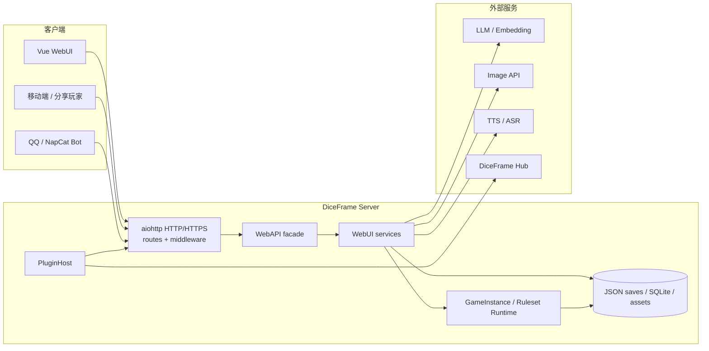

# 01 项目总览

> 对应代码版本：`3.0.3` · `main@03c6da6` · 2026-10-28

## 1. 这是什么项目

DiceFrame 是一个**可自托管的 AI 桌上角色扮演（TRPG）引擎**。玩家用自然语言描述行动，系统把行动交给 GM 模型叙事，同时由服务端规则层完成检定、状态变更、战斗结算与持久化，再通过 Web / Bot / SSE 投影回客户端。

它不是“聊天框 + 提示词”，而是一个包含以下子系统的完整应用：

- 单人 / 多人游戏运行时与房间权限；
- 世界、规则、角色、冒险、世界书等内容系统；
- 权威 `WorldState`（世界事实、逻辑时钟、定时事件、行动合法性）；
- Player Control 与 AI 托管席位（human / ai / unclaimed）；
- LLM GM、结构化检定、长期记忆、Hybrid 世界书检索；
- D&D 2024 权威 runtime，以及 CoC / Freeform / 自定义规则的兼容路径；
- 权威战斗 reducer、通用战斗 primitives、经济结算与回滚；
- 插件宿主、渠道 Bot（如 QQ / NapCat）、Image / TTS / ASR 媒体能力；
- Vue 3 Web 前端、SSE 推送、分享与直连；
- Source / Windows Portable / Docker 三种部署与更新路径。

---

## 2. 技术栈

### 后端

| 类别 | 选型 | 说明 |
|---|---|---|
| 语言 | Python 3.10+（推荐 3.11） | CI 与 Docker 均使用 3.11 |
| Web | `aiohttp>=3.9,<4` | 自建 HTTP/HTTPS 服务，无 FastAPI/Django |
| ORM / DB | `peewee>=4.5,<5` + SQLite | 世界书与记忆库；WAL 模式 |
| AI | `pydantic-ai-slim==1.107.7`、自研 `LLMClient` | OpenAI-compatible + Anthropic Messages |
| 媒体 | `Pillow`、`edge-tts`、`pypdf` | 图像、TTS、PDF 导入 |
| 加密 | `cryptography` | TLS / 凭据相关 |
| 测试 | `pytest`、`pytest-asyncio`、`pytest-cov` | `tests/` 顶层目录 |
| 质量 | `ruff`、`mypy` | `ruff` 只启用正确性规则；`mypy` 白名单渐进覆盖 |

依赖清单：[requirements.txt](../../requirements.txt)、[requirements-dev.txt](../../requirements-dev.txt)、[pyproject.toml](../../pyproject.toml)。

### 前端

| 类别 | 选型 |
|---|---|
| 框架 | Vue `3.5.44` + TypeScript `5.7.3` |
| 构建 | Vite `8.1.4` + `vue-tsc` |
| 状态 | Pinia `3.0.4` |
| 路由 | `vue-router 5.1.0`（hash history） |
| UI | `naive-ui 2.44.1`、`reka-ui`、`lucide-vue-next` |
| 样式 | Tailwind CSS `4.3` + 分层 CSS |
| i18n | `vue-i18n 11` |
| 测试 | Vitest `4.1.12`、Playwright `1.61.1` |

依赖清单：[frontend-v2/package.json](../../frontend-v2/package.json)。

### 存储

| 数据 | 形式 | 位置（默认） |
|---|---|---|
| 运行时配置 | JSON | `data/config.json` |
| 密钥 | JSON | `data/secrets.json` |
| 访问令牌 | 文本 | `data/access_token.txt` |
| 对局存档 | JSON + 聊天日志 | `data/saves/` |
| 世界书 | SQLite | `data/lorebook.db` |
| 长期记忆 | SQLite | `data/memory.db` |
| 模板 | JSON 文件 | `data/templates/`（从 `templates/` 同步） |
| 生成图片 | 文件 | `data/generated-images/` |
| TTS 缓存 | 文件 | `data/tts-cache/` |
| 内容缓存 | 文件 | `data/content-cache/` |
| 插件 | 目录 | `data/plugins/`、`data/plugin-packages/` |

---

## 3. 仓库地图

```text
diceframe/
├─ web_server.py              # 进程入口：配置、监听器、优雅关闭
├─ src/
│  ├─ engine/                 # 单局聚合、骰子、经济、战斗 primitives、持久化 projection
│  ├─ commands/               # 回合编排、检定规划、LLM 处理、状态应用
│  ├─ webui/                  # aiohttp app、routes、services、WebAPI facade、访问控制
│  ├─ web_transport/          # HTTP/HTTPS、TLS、监听器、endpoint
│  ├─ rulesets/               # 版本化规则 runtime（legacy adapter + dnd2024）
│  ├─ rules/                  # Legacy RuleSystem / 规则模板加载
│  ├─ adventures/             # 冒险包加载、图结构、解析、进度、场景上下文
│  ├─ content/                # Content V2、GM style、locale
│  ├─ content_modules/        # 内容模块 refs / plan / projection / sync
│  ├─ lorebook/               # 世界书存储、匹配、Hybrid 检索、导入导出
│  ├─ memory/                 # 长期记忆、embedding、摘要、召回
│  ├─ llm/                    # LLM 客户端、上下文构建、协议解析、工具调用
│  ├─ migrations/             # GameInstance / Lorebook / Memory schema 迁移
│  ├─ plugin_host/            # 插件宿主、生命周期、能力、市场、镜像
│  ├─ plugin_sdk/             # 插件运行时 SDK（tool / provider / bridge）
│  ├─ bots/                   # Bot 桥接共用逻辑（bridge_core）
│  ├─ generation/             # 世界/规则/角色/文本生成
│  ├─ imagegen/               # 图像生成服务、资产、分镜
│  ├─ tts/ · asr/             # 语音合成 / 识别
│  ├─ launcher/               # Windows Portable 启动器
│  ├─ docker_launcher/        # Managed Docker 启动与数据版本
│  ├─ compat/                 # 旧格式兼容边界
│  └─ localization/           # 语言注册表与策略
├─ frontend-v2/               # Vue 3 前端源码
├─ static-v2/                 # 前端构建产物（由 CI/本地 build 生成）
├─ templates/                 # 内置规则、世界、冒险、世界书模板
├─ prompts/                   # GM 提示词模板
├─ plugins/                   # 内置插件与示例
├─ tests/                     # 后端测试（含 architecture / integration / rulesets）
├─ docs/                      # 架构、工程规则、ADR、用户文档、本 Wiki
├─ scripts/                   # 构建、审计、E2E、发布脚本
├─ Dockerfile · docker-compose*.yml
└─ pyproject.toml · requirements*.txt
```

### 关键目录规模（当前检出）

- `src/webui/services/`：约 99 个 Python 服务文件，按功能域拆分；
- `src/webui/routes/`：约 50 个路由注册模块；
- `src/engine/modules/`：34 个模块状态拥有者；
- `tests/`：约 490 个测试文件，重点覆盖权限、迁移、并发、经济幂等、LLM 边界、插件安全。

---

## 4. 运行时拓扑



关键边界：

- 浏览器、Bot、插件、LLM **都不是最终游戏状态权威**；
- `GameInstance`、规则 runtime、服务端 reducer/resolver 才拥有机械与持久状态；
- 插件通过内部 HTTP API 或受限 RPC 与主程序交互，不能直接持有核心对象。

---

## 5. 一次典型游玩的组成

```text
创建对局
  → 选择世界 / 规则 / 冒险 / 角色
  → 生成 GameInstance（含 ruleset binding、world state、player control）
  → 玩家提交行动
  → Check Planner 提出检定候选
  → 服务端 normalize + 规则判定 + 骰子
  → PromptComposer 组装上下文
  → LLM 生成叙事与候选 tags
  → StateUpdateApplier / Ruleset reducer 提交权威状态
  → 持久化 + memory outbox
  → SSE / Bot 投影
```

详细链路见 [02 架构与权威模型](02-architecture-and-authority.md) 与 [04 游戏引擎与回合](04-game-engine-and-turns.md)。

---

## 6. 当前明确没有的能力

以下能力在源码中尚不存在，不要在开发时假设它们可直接复用：

- 通用 Entity Registry / Relation Graph；
- 完整长流程（long-running process）引擎；
- 地图拓扑 / Pathfinding；
- 统一的 Confirmed Event → World Memory Manager；
- 跨规则集共享的通用 Class Feature Runtime（当前只有 D&D 2024 专属 `features/`）；
- 前端直接执行规则计算或持久化写入。

`WorldState v1` 已有 facts / clock / scheduled events，但这不等于完整世界模拟器。

---

## 7. 从哪里开始读代码

| 目标 | 第一入口 |
|---|---|
| 启动与依赖装配 | [web_server.py](../../web_server.py) → [composition.py](../../src/webui/composition.py) → [application.py](../../src/webui/application.py) → [bootstrap.py](../../src/webui/bootstrap.py) |
| 单局状态 | [game_instance.py](../../src/engine/game_instance.py) |
| 回合编排 | [turns.py](../../src/webui/services/turns.py) → [game_handler.py](../../src/commands/game_handler.py) → [round_processor.py](../../src/commands/round_processor.py) |
| 检定 | [check_planner.py](../../src/commands/check_planner.py) → [checks.py](../../src/engine/checks.py) |
| LLM | [client.py](../../src/llm/client.py) → [context_builder.py](../../src/llm/context_builder.py) → [parser.py](../../src/llm/parser.py) |
| 规则运行时 | [contracts.py](../../src/rulesets/contracts.py) → [registry.py](../../src/rulesets/registry.py) → [dnd2024/runtime.py](../../src/rulesets/dnd2024/runtime.py) |
| 世界书 | [store.py](../../src/lorebook/store.py) → [retrieval.py](../../src/lorebook/retrieval.py) |
| 前端 | [main.ts](../../frontend-v2/src/main.ts) → [router/index.ts](../../frontend-v2/src/router/index.ts) → [features/play/PlayView.vue](../../frontend-v2/src/features/play/PlayView.vue) |
