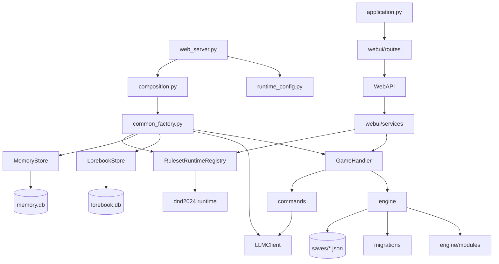

# 02 架构与权威模型

> 本文是 [ARCHITECTURE_CN.md](../ARCHITECTURE_CN.md) 的开发者导读版：保留判断“代码应该写在哪一层”所需的核心事实，细节仍以架构文档与源码为准。

## 1. 分层与依赖方向

```text
Frontend / Bot / Plugin Client
          │
          ▼
   HTTP Routes / SSE
          │
          ▼
        WebAPI （委托 facade）
          │
          ▼
 WebUI Application Services
          │
          ├──────────────┐
          ▼              ▼
     GameHandler     Ruleset Runtime
          │              │
          ▼              ▼
  Generic Engine / Rules / Content
          │
          ├──────────────┬──────────────┐
          ▼              ▼              ▼
      Saves         Lorebook DB      Memory DB
```

### 1.1 依赖关系总览



外部依赖：

| 依赖 | 使用方 | 说明 |
|---|---|---|
| `aiohttp` | webui / web_transport / llm / bots | HTTP 服务与客户端 |
| `peewee` | lorebook / memory | SQLite 查询构造 |
| `pydantic-ai-slim` | DF Agent 框架 | 工具调用的 Agent 编排与审批 |
| `Pillow` | imagegen / bot card renderer | 图像处理 |
| `edge-tts` | tts | 零配置语音 |
| `pypdf` | adventure / content import | PDF 文本提取 |
| `cryptography` | web_transport / credentials | TLS 与加密 |
| 远端 LLM / Embedding / Image / TTS | llm / memory / imagegen / tts | 通过 provider 引用配置 |

### 1.2 硬边界（由测试保护）

[tests/architecture/test_dependencies.py](../../tests/architecture/test_dependencies.py) 使用 AST 级 import 分析保护真实依赖方向：

| 层 | 不得依赖 |
|---|---|
| `engine` / `generation` / `lorebook` / `memory` / `rules` | `webui`、具体 `dnd2024` runtime、随意的 legacy compat |
| `rulesets` | `webui` / `compat` |
| `dnd2024/combat` | `campaign` / `webui` |
| `adventures` | 具体 ruleset / `webui` / `compat` |
| `web_transport` | 游戏、规则、WebUI 业务 |
| 游戏 / 规则 / AI 层 | TLS、证书、具体 transport |

其他架构守卫：

- [test_module_pluggability.py](../../tests/architecture/test_module_pluggability.py)：核心流程对能力模块的点名调用只减不增；
- [test_game_instance_facades.py](../../tests/architecture/test_game_instance_facades.py)：`GameInstance` 上残留的模块门面 property 只减不增；
- [test_versioned_ruleset_binding.py](../../tests/architecture/test_versioned_ruleset_binding.py)：规则绑定与版本约束；
- [test_world_runtime_boundaries.py](../../tests/architecture/test_world_runtime_boundaries.py)：WorldState 写入边界；
- [test_content_authority.py](../../tests/architecture/test_content_authority.py)：内容权威边界。

> 新增代码时，如果发现需要“反向依赖”才能完成，通常说明职责放错层，而不是需要放宽测试。

---

## 2. Authority Model：谁有权决定什么

| 参与者 / 层 | 可以做 | 不可以直接做 |
|---|---|---|
| 浏览器前端 | 提交 intent / 行动文本 / 选择 / 确认；显示 projection | 提交可信伤害、余额、权限结论、战斗结果 |
| Bot / Channel Adapter | 代表合法 actor 调用 HTTP API | 绕过 actor / game / room 权限 |
| LLM GM | 叙事、生成候选 tags / check plans / proposals | 成为 persisted mechanics authority |
| Check Planner LLM | 提出“需要什么检定”的候选 | 最终决定合法 actor、数值、骰子结果 |
| Ruleset Runtime | 解释规则、验证 intent、resolve、apply event | 反向控制 WebUI / transport |
| GameInstance | 单局权威状态与生命周期 | 感知 HTTP、TLS、Vue 等表现层 |
| Economy Engine | 余额、proposal、transaction、rollback | 让模型文本直接扣钱 |
| Memory Store | 长期记忆外部存储 | 在权威 settlement 前自行写入 |
| Plugin | 声明 contribution / capability / RPC | 绕过 host 权限直接成为核心 authority |
| Web Transport | HTTP/HTTPS、listener、cert、endpoint | 感知游戏规则 |

### 判断 authority 的三个问题

接任何 issue / PR 前先问：

```text
1. 这个功能的最终 authority 在哪里？
2. 用户请求从哪里进入，经过哪些 service / runtime？
3. 我现在要改的是表现层、应用编排，还是权威状态？
```

最常见的问题不是“代码写错”，而是“在错误的层写了一份正确逻辑”，例如：

```text
前端自己计算 D&D 规则
LLM 文本直接修改 HP
AI 托管复制一份角色
WorldState 和 memory 各记一份“当前世界”
service 之间互相 import 形成环
```

---

## 3. 状态 Ownership Matrix（节选）

| 数据 / 状态 | 权威 Owner | 持久化 | 只读 Projection | Mutation Path |
|---|---|---|---|---|
| Game lifecycle | `GameInstance` | save | game detail | lifecycle / turns |
| WorldState | `GameInstance.world_state` + `src/engine/world_state.py` | save | visible world / LLM context | `apply_world_ops` / world events |
| Player control | player record + `player_control.py` | save | roster / game detail | game controls / claim seat |
| Players | `GameInstance` | save | generic context / UI | character services |
| Canonical D&D character | D&D runtime | save under player/companion | legacy projection | character lifecycle |
| Ruleset state | Ruleset runtime | save | gameplay / LLM view | intents + reducers |
| Combat result | Ruleset reducer | event ledger / state | combat UI | authoritative intent |
| Legacy combat | `GameInstance` + `CombatResolver` | save | generic UI | round / combat resolver |
| Economy balances | Economy + character state | save | UI / trusted context | proposal settlement |
| Economy proposals | Economy | save | proposal card | planner / GM / payer |
| Memory | `MemoryStore` | SQLite | context retrieval | outbox delivery |
| Lorebook | `LorebookStore` | SQLite | localized read view | content / world management |
| Adventure graph | Adventure Bundle | files | runtime read | package management |
| World template | Content V2 | files / DB | localized read | content management |
| Ruleset bundle | Ruleset Bundle | files | runtime catalog | package release |
| Scene image asset | Image backend | asset files | reference | image service |
| `scene_image` ref | `GameInstance` | save | timeline / UI | generated image service |
| Plugin state/process | `PluginHost` | plugin data/config | admin UI | host lifecycle |
| Runtime config | `ConfigStore` | `config.json` / `secrets.json` | settings | `ConfigController` |
| HTTP listener | `web_transport` / `web_server` | runtime only | system status | restart |

---

## 4. 三条真实请求链

### 4.1 普通玩家行动

```text
ActionComposer / Bot
  ↓
POST /api/games/{game_key}/action
  ↓
turns.submit_action
  ↓
validate actor / run / state
  ↓
GameInstance.add_action
  ↓
save action
  ↓
多人 barrier
  ↓
AI-hosted seat 补行动（若需要）
  ↓
GameInstance.try_advance
  ↓
RoundProcessor.process_round
  ↓
Check Planner
  ↓
server normalize / rules / dice
  ↓
PromptComposer
  ↓
LLM GM
  ↓
stale fence
  ↓
state / economy / deferred effect gate
  ↓
authoritative save
  ↓
memory outbox
  ↓
SSE / Bot projection
```

### 4.2 玩家控制权切换

```text
Web / Bot 控制请求
  ↓
GameControlService
  ↓
control_change_block
  ↓
players[uid].control
  ↓
revision++
  ↓
save
  ↓
human → ai 时 resume_after_control_change
  ↓
复用原 turns progression
```

### 4.3 权威 D&D 战斗

```text
Intent
  ↓
D&D validation
  ↓
resolution
  ↓
EventBatch
  ↓
combat reducer
  ↓
canonical combat state
  ↓
projection
  ↓
LLM 只负责叙述已确认结果
```

---

## 5. 单局并发模型

### 5.1 三层锁

固定顺序：

```text
_authority_lock
      ↓
_process_lock
      ↓
_lock
```

| 锁 | 保护范围 |
|---|---|
| `_authority_lock` | 历史 rewrite、aggregate replacement、高级 authority gate |
| `_process_lock` | `process_round`、`generate_swipe`；同局不能并发跑两条完整叙事流水线 |
| `_lock` | 细粒度状态变更、行动队列、状态切换 |

### 5.2 `run_id` 围栏

```text
game_key = 这是哪一局槽位
run_id   = 这个槽位现在是哪一次运行
```

重开后 `game_key` 不变、`run_id` 变化。任何写路径若携带旧 `run_id`，必须被拒绝：

```text
request.expected_run_id == current_instance.run_id
```

### 5.3 Aggregate Replacement

重开 / 重置不是逐字段清空旧对象，而是：

```text
Old GameInstance
  ├─ lock authority
  ├─ construct candidate
  ├─ initialize candidate
  └─ atomic registry replacement → New GameInstance
```

等待锁的旧 writer 恢复后仍指向旧 object / 旧 run，会被 stale fence 拦截。

---

## 6. 能力模块与 Module Hooks

### 6.1 设计目标

核心流程只调用固定钩子点，不点名具体能力模块。没有模块注册的钩子点是空操作；删除某个能力模块后，游戏仍可运行，只是缺少对应展示/报告。

实现：[src/engine/module_hooks.py](../../src/engine/module_hooks.py)。

### 6.2 钩子点（封闭集合）

| 钩子 | 时机 |
|---|---|
| `round.reset` | 清理轮次作用域状态 |
| `round.processing.begin` | 开始处理新一轮 |
| `instance.reset.preflight` | 原地 reset 前预检，可拒绝 |
| `instance.reset.begin` | 预检通过、旋转 run 之前 |
| `instance.reset` | 原地重置 run 作用域状态 |
| `instance.new_run.preflight` | 创建替代 run 前预检 |
| `instance.new_run` | 把可选偏好带到新 run |
| `round.recovery.preflight` | 回合回滚/中止前预检 |
| `round.abort` | 判定失败后恢复本轮状态 |
| `round.rewind.begin` | 历史回退/rewind 前 |
| `round.rewind.restore` | 恢复目标轮日志携带的模块状态 |
| `round.commit` | `finish_judgment` 生成日志条目后 |
| `npc.admission` | 叙事 NPC 状态写入准入 |
| `authority.write.allowed` | 是否允许普通 run 写入 |
| `checks.skill_use.settled` | 服务端结算的技能成长记录 |
| `seat.preflight` / `seat.acted` / `seat.forgotten` / `seat.has_acted` | 席位行动锁 |
| `module.state.record` / `module.state.read` / `module.state.write.preflight` | 模块持有状态读写 |
| `combat_view` | 只读战斗回合视图 |

### 6.3 内核模块 vs 能力模块

`KERNEL_MODULES`（不可通过钩子缺失）：

```text
adventure_runtime_state
checks
content_binding
progression_state
round_safety
ruleset_runtime
session_stats
```

建局组中另有内核模块：`room_access`、`economy_state`、`game_config`。

`resource_recovery` 是 authority 例外：当前 writer 要求其槽与生命周期钩子始终存在，即使规则未声明恢复策略也要保持可读、可校验、可回退；缺少 policy 时功能关闭，而不是卸载模块。

### 6.4 模块状态读写

模块通过 `STATE_RECORD` / `STATE_READ` 暴露自己的状态 kind，例如：

```text
overreach / world_legality / world_events
quick_actions / gm_directives / combat_results
state_update / token_budget_bump
lorebook_timers / health_events / health_status
check_reveals / away_control_policy
private_log / table_talk / combat_view
scene_image / map_background
combat_extension / combat_extension_snapshot
```

调用方通过 `module_hooks.ask(...)` 读取，不得直接访问模块内部字典。完整列表见 [10 关键类与接口速查](10-key-reference.md)。

---

## 7. 扩展应该改哪里

| 需求 | 正确扩展点 | 不应做 |
|---|---|---|
| 新增完整规则集 | `src/rulesets/<new_runtime>/` + `RulesetRuntime` + binding + capabilities + bundle | 在 generic d20 里加 `if new_rule` |
| 新增通用战斗 primitive | `src/engine/combat_*`，且多个规则确有共性 | 把具体法术/职业 identity 塞进 engine |
| 新增 persisted 字段 | `GameInstance` → `GamePersistedState` → codec encode/decode → migration → projection → rollback/reset 语义 → tests | 只加 dataclass field |
| 新增 Web 功能 | route → WebAPI delegate → service → core/ruleset | route 里直接构造业务对象 |
| 新增 transport 参数 | `src/web_transport/` | 进入 engine |
| 新增 plugin capability | 插件实现 + SDK contract + capability descriptor + tests | 直接改核心业务 |
| 新增模型 provider | `ai_providers` + `*_provider_ref` | 恢复旧式散落地址/密钥字段 |
| 新增展示/文案 | 前端 feature 组件 + i18n | 改核心规则与持久化 |

完整扩展矩阵见 [ARCHITECTURE_CN.md §49](../ARCHITECTURE_CN.md#49-extension-matrix新增功能应该改哪里)。

---

## 8. 常见错误路径

| 错误做法 | 后果 |
|---|---|
| 前端直接算规则并写回 | 产生第二套 authority |
| LLM 返回 JSON 后直接改 HP | 绕过规则验证与回滚 |
| service 之间互相 import | 形成循环依赖，架构测试失败 |
| 在 `GameInstance` 上新增模块门面 property | 门面债基线只减不增，CI 失败 |
| 在 generic engine 增加 D&D 分支 | ruleset 隔离测试失败 |
| 通过删除测试隐藏回归 | 违反工程规则 §15 |

---

## 9. 进一步阅读

- [ARCHITECTURE_CN.md](../ARCHITECTURE_CN.md)：完整架构事实；
- [ENGINEERING_RULES.md](../ENGINEERING_RULES.md)：稳定表面、迁移、兼容、测试规则；
- [docs/adr/](../adr/README.md)：关键决策记录；
- [03 后端运行时](03-backend-runtime.md)：请求如何进入服务层；
- [04 游戏引擎与回合](04-game-engine-and-turns.md)：状态如何被权威修改。
