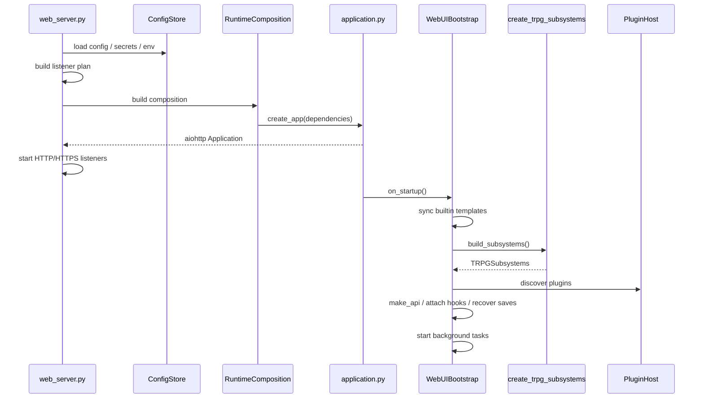

# 03 后端运行时：启动、HTTP 与应用服务

> 入口文件：[web_server.py](../../web_server.py) · 应用工厂：[application.py](../../src/webui/application.py) · 依赖装配：[composition.py](../../src/webui/composition.py) · 启动任务：[bootstrap.py](../../src/webui/bootstrap.py)

## 1. 为什么拆成四个 Owner

| 模块 | Owner | 不负责 |
|---|---|---|
| `web_server.py` | 环境入口、真实监听、进程信号 | 业务装配细节 |
| `runtime_config.py` | 配置来源、校验、写盘 | 业务对象构造 |
| `composition.py` | runtime dependency graph | 读写环境变量、启动监听 |
| `application.py` | aiohttp app / middleware / routes | 启动恢复、插件进程 |
| `bootstrap.py` | startup / recover / plugin / 后台任务 / cleanup | HTTP 形状 |

好处：import 一个模块不会触发配置迁移写盘；listener 与游戏业务不互相引用；测试启动逻辑不必真的开端口。

---

## 2. 启动序列



### 2.1 `web_server.py` 关键步骤

1. Docker 托管模式下先执行 `prepare_version_data(...)`；
2. `load_project_env(.env)`；
3. `RuntimePaths.from_root(ROOT, os.environ)` 决定数据与模板目录；
4. `ConfigStore.load()` 读取 `config.json` / `secrets.json`；
5. `build_listener_plan(...)` 决定监听地址、HTTP/HTTPS 端口与内部 API 基址；
6. `create_app(ApplicationDependencies(...))` 构造 app；
7. `start_listeners(...)` 真正绑定；
8. `run_with_graceful_shutdown(...)` 处理 Ctrl+C / 重启请求；必要时 `os.execv` 重启进程。

### 2.2 `bootstrap.on_startup` 关键顺序

```text
sync_builtin_templates()            # 内置 rules / worlds / adventures 同步到 data/templates
initialize_access_password()        # owner 登录口令
ensure_bot_token()                  # Bot API token
build_subsystems()                  # GameRegistry / LLM / Lorebook / Memory / RulesetRegistry / GameHandler
create HubClient（可选）
create PluginHost + discover()
make_api(subsystems, plugin_host, hub_client)
attach_package_hooks / refresh_content_sources
create UpdaterService
registry.recover_all()              # 恢复未结束的存档
start_background():
  ├─ recover_economy_outboxes()
  ├─ plugin_host.start_enabled()
  ├─ embed_pending_memories()
  ├─ periodic_save()
  ├─ prefetch_remote_indexes()
  └─ certificate_renewal_loop()
```

`on_cleanup` 负责停止后台任务、保存活跃对局、关闭插件与模型客户端。

---

## 3. Composition Root 与 `TRPGSubsystems`

### 3.1 `TRPGSubsystems`

[src/common_factory.py](../../src/common_factory.py)：

```python
@dataclass
class TRPGSubsystems:
    registry: GameRegistry
    llm_client: LLMClient
    lorebook_store: LorebookStore
    lorebook_matcher: KeywordMatcher
    memory_store: MemoryStore
    ruleset_registry: RulesetRuntimeRegistry
    handler: GameHandler
    check_llm_client: LLMClient | None = None
```

`create_trpg_subsystems(...)` 负责：

- 首次启动执行 `migrate_legacy_world_ids(...)`；
- 打开 `lorebook.db` / `memory.db`；
- `seed_builtin_worlds(...)`；
- 构建 `RulesetRuntimeRegistry`；
- 构建 `GameHandler`；
- 仅在完整构建成功后切换 embedding client（避免破坏旧运行时）。

### 3.2 Provider 解析

[src/webui/composition.py](../../src/webui/composition.py) 的 `RuntimeComposition` 把配置转换为：

| 能力 | 配置来源 |
|---|---|
| 主模型 | `llm_provider_ref` + `model` |
| Fallback 1/2 | `fallbackN_enabled` + `fallbackN_provider_ref` + `fallbackN_model` |
| Check 模型 | `check_model_enabled` + `check_provider_ref` + `check_model` |
| Embedding | `embedding_enabled` + `embedding_provider_ref` + `embedding_model` |
| TTS / ASR / ImageGen | `<capability>_provider_ref` |

`config_with_resolved_api_refs(...)` 把共享服务商解析成运行时内部键；解析失败时：

- TTS 回退 `browser`；
- ASR 回退 `disabled`；
- ImageGen 关闭。

> **AI 配置契约**：只支持 `ai_providers` + `*_provider_ref`，密钥存为 `ai_provider_key_<id>`。旧式直填地址/密钥字段必须拒绝，不自动迁移。

---

## 4. aiohttp Application

### 4.1 Middleware 顺序

[src/webui/application.py](../../src/webui/application.py) 中顺序固定：

```text
cors_middleware
  → update_admission
  → session_middleware
  → abuse_guard_middleware
  → auth_middleware（WebAccessControl）
  → error_code_middleware
  → run_write_admission
```

`on_response_prepare`：

```text
cors_response_prepare
  → add_response_security_headers
```

### 4.2 Application 上的共享对象

| Key | 内容 |
|---|---|
| `app["api"]` | `WebAPI` facade |
| `app["subsystems"]` | `TRPGSubsystems` |
| `app["plugin_host"]` | `PluginHost` |
| `app["hub_client"]` | `HubClient` 或 `None` |
| `app["updater"]` | `UpdaterService` |
| `app["sse_tickets"]` | `SseTicketStore` |
| `app["connection_pool"]` | SSE 连接池 |
| `app["session_manager"]` | `SessionManager` |
| `app["security_transport"]` | `SecurityTransportService` |
| `app["runtime_control"]` | boot id / restart 标志 |
| `app["web_transport"]` | `ServerTransport` |
| `app["_config_reload_lock"]` | 配置热重载互斥 |

### 4.3 Route 注册

路由按领域拆分，[application.py](../../src/webui/application.py) 的 `register_routes(...)` 统一调用：

```text
pages / auth / pairing / games / bot / plugins / security
announcements / hub / legal / assistant / tunnel / system
updater / speech / asr / generated_images
worlds / lorebooks / rules / adventures / modules
character_cards / content / content_review / avatars
scene_images / maps / generation / sse / memory
```

每个 `src/webui/routes/<domain>.py` 暴露一个 `register_<domain>(app)`；handler 内部只做 HTTP 形状、权限检查与 `api.<method>()` 委托。

代表路由：

| 领域 | 代表端点 |
|---|---|
| 对局 | `GET/POST /api/games`、`POST /api/games/create`、`GET /api/games/{game_key}` |
| 行动 | `POST /api/games/{game_key}/action`、`/advance`、`/swipe/{round}` |
| 规则玩法 | `/intents`、`/combat/action`、`/check-modes`、`/checks/{id}/push/{op}` |
| SSE | `POST /api/games/{game_key}/sse-ticket`、`GET /api/games/{game_key}/sse` |
| 角色 | `/api/character-cards`、`/api/games/{game_key}/characters` |
| 世界书 | `/api/lorebooks`、`/api/games/{game_key}/lorebooks` |
| 内容 | `/api/content/import/{preview,commit}`、`/api/adventures` |
| 插件 | `/api/plugins`、`/api/plugins/{id}`、市场与镜像端点 |
| 配置 | `/api/config`、`/api/test-connection`、`/api/test-embedding` |
| Bot | `/api/bot/ping`、`/api/bot/bind-game`、`/api/games/{game_key}/bot-bind-token` |

完整端点分组见 [10 关键类与接口速查](10-key-reference.md#2-http-路由分组)。

---

## 5. WebAPI：委托 Facade

[src/webui/api.py](../../src/webui/api.py) 的 `WebAPI` 是 Web 层对业务能力的统一入口：

- 构造时接收 `GameRegistry`、`LorebookStore`、`MemoryStore`、`GameHandler`、`LLMClient`、`RulesetRuntimeRegistry`、`PluginHost`、媒体服务与配置；
- 在 `__init__` 中组合各功能 service（如 `AISeatService`、`CheckDecisionService`、`GamePreferenceService`、`RecoveryService`、`RunStoryService`、`CheckModeService`）；
- 把 `AdventureResolver` 注入 ruleset registry，保证 WebAPI 与 D&D runtime 共用同一个冒险解析器；
- 方法通常只做参数整理、权限/依赖检查，然后把工作交给 `src/webui/services/`。

> 架构债务：`WebAPI` 仍是较大的 facade。新代码应优先建独立 service，并把依赖显式传入，而不是继续把状态塞进 `WebAPI` 或通过 `api._private` 穿透。

---

## 6. 应用服务层（`src/webui/services/`）

服务按功能域拆分，以下为高频模块：

| 域 | 主要 service | 职责 |
|---|---|---|
| 回合 | `turns.py` | 提交行动、多人 barrier、推进、Luck 后续、创建后恢复 |
| 生命周期 | `game_lifecycle.py`、`game_seed_lifecycle.py`、`game_creation_phases.py` | 创建、开始、reset、restart、种子局 |
| 查询 | `game_queries.py` | 大厅、详情、日志、参与者上下文 |
| GM | `game_master.py` | GM 指令、私聊、强制推进、叙事控制 |
| 控制权 | `game_controls.py`、`ai_seats.py`、`seat_tokens.py` | human/ai/unclaimed、暂离托管、席位令牌 |
| 偏好 | `game_preferences.py` | 本局偏好、默认继承、GM-only 写入 |
| 规则玩法 | `ruleset_gameplay.py`、`ruleset_characters.py`、`ruleset_advancement.py`、`ruleset_rest.py` | intent、角色卡、升级、休息 |
| 通用战斗 | `combat_extension.py` | 动作效果、资源池、调度器 |
| 恢复 | `resource_recovery.py`、`recovery_projection.py` | SAN/Luck 一次性恢复、回执 |
| 检定 | `check_decisions.py`、`check_modes.py`、`check_reveals.py`、`manual_rolls.py` | Push、检定模式、揭示、手动骰 |
| 角色 | `characters.py`、`character_cards.py`、`character_card_import.py` | 角色生命周期、角色卡导入导出 |
| 世界书 | `lorebooks.py`、`game_lorebooks.py`、`lorebook_visibility_plans.py`、`lorebook_usage.py` | CRUD、本局绑定、可见性、使用统计 |
| 内容 | `worlds.py`、`rules.py`、`adventures.py`、`content.py`、`content_sync.py`、`content_recovery.py`、`content_pack_export.py` | 内容库、导入导出、恢复 |
| 模组 | `modules.py`、`module_resources.py`、`module_forks.py`、`module_import_adapters.py` | 模组安装、资源、分叉 |
| 媒体 | `generated_images.py`、`scene_images.py`、`game_media.py`、`avatars.py`、`maps.py`、`map_backgrounds.py` | 图像、场景图、头像、地图 |
| 语音 | `speech.py`、`asr.py` | TTS / ASR |
| 记忆 | `memory.py` | 记忆查询、编辑、召回 |
| 插件 | `plugins.py` | 插件管理、安装、市场 |
| 助手 | `assistant*.py`、`kp_questions.py`、`knowledge.py` | DF Agent、知识、KP 问答 |
| 剧情 | `run_story.py`、`storytelling.py`、`story_adventure.py` | 跑团计划、幕间、结团 |
| 系统 | `system.py`、`updater.py`、`logs.py`、`hub.py`、`announcements.py`、`legal.py` | 系统状态、更新、日志、Hub、公告、法务 |
| 安全 | `security.py`、`room_password.py`、`bot_access.py`、`tunnel.py` | 房间密码、Bot 访问、隧道 |

---

## 7. 访问控制与安全边界

[src/webui/access_control.py](../../src/webui/access_control.py) 统一处理：

| 身份 | 凭据 |
|---|---|
| Owner | 登录口令 / `access_token.txt` / 设备令牌 |
| Player share | 分享链接或席位令牌 |
| Bot | Bot API token / 绑定凭证 |
| SSE | 一次性 ticket |
| Plugin | 内部 API token |

关键规则：

- 房间密码只做遮挡与准入，不是数据加密；
- SSE 必须先换取 ticket，避免 token 出现在 URL 长期日志；
- 删除类操作要求确认（前端确认对话框 / `X-TRPG-Confirm` 头）；
- 任何前端 capability gating 都只是体验层，服务端必须重新校验。

配对与设备令牌：

- `src/webui/device_tokens.py`：owner 设备令牌；
- `src/webui/pairing.py`：一次性配对码 / 手机扫码登录；
- `src/webui/sse_ticket.py`：SSE grant 与撤销。

---

## 8. SSE 与实时投影

实现：[src/webui/routes/sse.py](../../src/webui/routes/sse.py)。

```text
客户端 POST /sse-ticket
  → 服务端校验成员身份
  → 签发短期 ticket
客户端 GET /sse?ticket=...&cursor=...
  → 连接保持
  → 新回合 / 状态变化写入事件
  → 断线后按 cursor 补发
```

要点：

- 游标格式包含 round / private / action / public 摘要；
- 订阅时校验 `user_id` 是否属于本局；
- 权限撤销会主动断开连接；
- 前端封装在 [client.ts](../../frontend-v2/src/api/client.ts) 的 `gameEventSource(...)` 与 [useGame.ts](../../frontend-v2/src/composables/useGame.ts)。

---

## 9. 配置热重载与重启

[src/webui/config_controller.py](../../src/webui/config_controller.py)：

```text
POST /api/config
  → 校验新配置
  → 写 config.json / secrets.json
  → 若模型或依赖变化：
      重建 subsystems（尽可能 reuse registry / DB）
      重建 WebAPI
      激活新 runtime
  → 若监听器变化：
      标记 restart_requested
      优雅关闭后 os.execv 重启
```

`app["_config_reload_lock"]` 防止并发重载。构建新 runtime 失败时保留旧 runtime 继续服务。

---

## 10. Web Transport

[src/web_transport/](../../src/web_transport/) 只负责监听与 TLS：

| 文件 | 职责 |
|---|---|
| `config.py` | 解析 host / port / TLS 配置 |
| `listeners.py` | 构建监听计划、启动多个 site、内部 API 地址 |
| `transport.py` | `ServerTransport` / endpoint 语义 |
| `lifecycle.py` | 优雅关闭 |
| `certificates/` | 自签名 / ACME / 证书续期 |

环境变量：`TRPG_WEB_HOST`、`TRPG_WEB_PORT`、`TRPG_WEB_HOSTS`、`TRPG_WEB_HTTP_PORT`、`TRPG_WEB_HTTPS_PORT`、`TRPG_TLS_*`。详见 [09 运行、测试与部署](09-run-test-deploy.md)。

> 插件使用 `TRPG_API_BASE` 连接内部 API。监听器真正启动后，`_align_internal_api(...)` 会复核地址；不匹配时更新并重启使用内部 API 的插件。

---

## 11. 关键类速查

| 符号 | 位置 | 职责 |
|---|---|---|
| `create_app` | [application.py](../../src/webui/application.py) | 构造 aiohttp app，不启动监听 |
| `register_routes` | 同上 | 按领域注册全部路由 |
| `ApplicationDependencies` | 同上 | app 创建所需显式依赖 |
| `RuntimeComposition` | [composition.py](../../src/webui/composition.py) | 构建 subsystems / WebAPI / 媒体服务 |
| `RuntimePaths` | [runtime_config.py](../../src/webui/runtime_config.py) | 数据与模板路径 |
| `ConfigStore` | 同上 | 配置读取、校验、隔离损坏 JSON、原子写 |
| `ConfigController` | [config_controller.py](../../src/webui/config_controller.py) | 配置热重载与重启 |
| `WebUIBootstrap` | [bootstrap.py](../../src/webui/bootstrap.py) | 启动、恢复、后台任务、清理 |
| `PluginHost` | [plugin_host/host.py](../../src/plugin_host/host.py) | 插件发现、启动、配置、安装 |
| `WebAPI` | [api.py](../../src/webui/api.py) | Web 层业务 facade |
| `WebAccessControl` | [access_control.py](../../src/webui/access_control.py) | 身份与中间件 |
