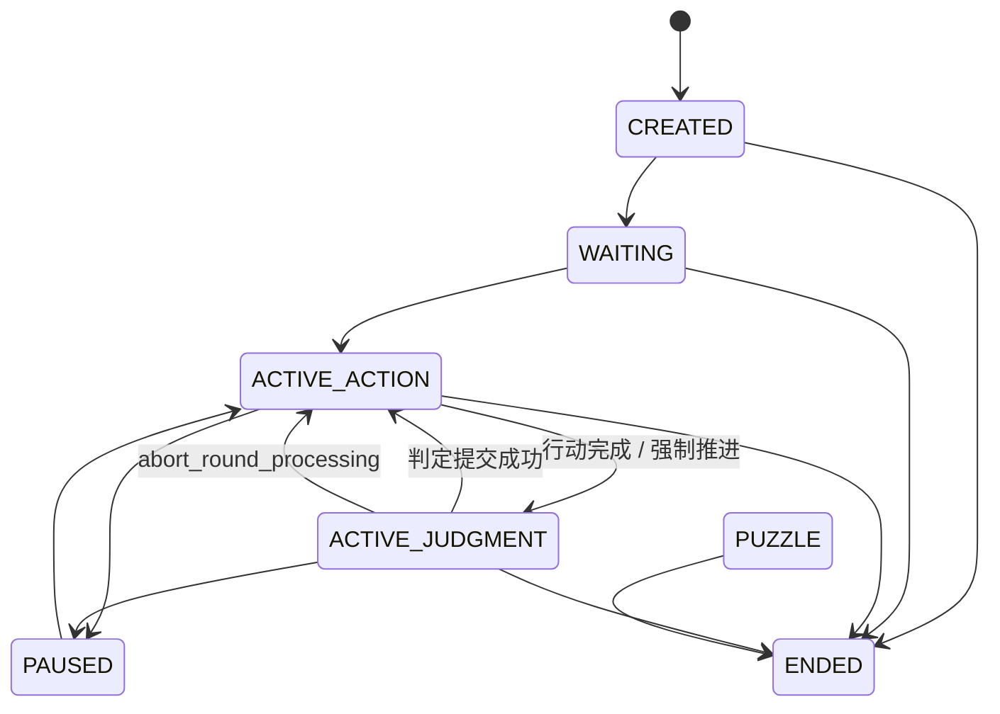

# 04 游戏引擎与回合流水线

> 核心文件：[game_instance.py](../../src/engine/game_instance.py) · [game_handler.py](../../src/commands/game_handler.py) · [turns.py](../../src/webui/services/turns.py) · [round_processor.py](../../src/commands/round_processor.py)

## 1. GameInstance：单局 Aggregate Root

[src/engine/game_instance.py](../../src/engine/game_instance.py) 中的 `GameInstance` 是**单局游戏的权威聚合**。一个实例对应一个 `game_key = (platform, target_id, account_id)`。

### 1.1 它拥有什么

| 类别 | 字段 / 来源 |
|---|---|
| identity | `game_key`、`instance_schema_version`、`run_id`、`memory_namespace` |
| 绑定 | `world_id`、`rule_id`、`adventure_binding`、`modules.ruleset_runtime.binding` |
| 生命周期 | `state: GameState`、`gm_uid` |
| 玩家 / NPC | `players`、`npcs`、`ready_players`、`away_players` |
| 行动 | `action_queue`、`pending_actions` |
| 日志 | `log`、`last_saved_log_count` |
| 世界 | `world_state`（facts / clock / scheduled_events / revision） |
| 模块状态 | `modules`（checks、economy_state、narrative_notes、round_safety、session_stats 等） |
| 叙事辅助 | `puzzle_manager`、`plot_tracker`、`round_unpriced_purchase_intents`、`language` |
| 运行时锁 | `_authority_lock`、`_process_lock`、`_lock`、`_process_task`、`_luck_timers` |

> 许多旧顶层字段已迁入 `src/engine/modules/`。`GameInstance` 上若仍保留 property，只是兼容门面；新代码应直接使用模块 API。尝试写入已退役门面会抛 `AttributeError`（`RETIRED_MODULE_FACADES`）。

### 1.2 生命周期状态

[src/engine/game_state.py](../../src/engine/game_state.py)：



`PUZZLE` 当前没有运行时入口，但保留为持久化枚举以兼容旧存档。

### 1.3 关键方法

| 方法 | 作用 |
|---|---|
| `authoritative_write(administrative=False)` | 进入活聚合写入闸门；历史 rewrite 期间拒绝写入 |
| `historical_rewrite()` | 历史改写（swipe / rollback）互斥闸门 |
| `rotate_run_identity()` | 生成新 `run_id`，重开后隔离旧写入 |
| `configure_game(...)` / `configure_session(...)` | 建局配置 |
| `bind_ruleset_runtime(binding)` / `bind_adventure(binding)` | 规则/冒险不可变绑定 |
| `add_action(...)` | 加入行动队列（锁内） |
| `commit_ai_player_action(...)` | AI 席位补行动，带 stale 检查 |
| `apply_action_roll(...)` | 行动内联骰子 |
| `try_advance()` / `_do_advance_locked()` | 多人 barrier 满足后推进 |
| `start_round(expected_run_id=...)` | 开启新一轮，校验 run |
| `finish_judgment(...)` / `finish_judgment_with_swipe(...)` | 提交判定与日志 |
| `rollback_last_round()` / `abort_round_processing()` | 历史回滚 / 本轮中止 |
| `cancel_round_processing(timeout=...)` | 取消在飞处理 |
| `reset(keep_seed=True)` | 原地重置 |
| `to_dict()` / `from_dict(data)` | 经 `GameStateCodec` 编解码 |

---

## 2. GameRegistry：对局槽位管理

[src/engine/game_instance.py](../../src/engine/game_instance.py) 的 `GameRegistry`：

| 方法 | 作用 |
|---|---|
| `get(game_key)` / `get_or_create(game_key)` | 查询 / 创建内存实例 |
| `register(instance)` / `remove(game_key)` | 注册 / 移除 |
| `list_active()` / `list_all()` | 活跃 / 全部 |
| `save(instance)` | 原子写存档 + 聊天日志 |
| `replace_current(game_key, candidate)` | 聚合替换（restart / reset） |
| `load(game_key)` / `recover_all()` | 读档 / 启动恢复 |
| `import_save_zip(...)` | 导入存档包 |
| `save_all_active()` | 定期保存 |

存档路径默认 `data/saves/`，具体文件由 [persistence.py](../../src/engine/persistence.py) 管理。

---

## 3. GameHandler：编排粘合层

[src/commands/game_handler.py](../../src/commands/game_handler.py) 不是 Aggregate Root，而是把多个领域能力组合起来：

```text
GameHandler
├─ GameFactory
├─ PromptComposer
├─ LoreRetriever
├─ StateUpdateApplier
├─ ProgressionResolver
├─ RoundProcessor
├─ CombatResolver
├─ DiceResolver
└─ PuzzleProcessor
```

关键入口：

| 方法 | 作用 |
|---|---|
| `create_game(...)` | 建局、初始化世界/角色 |
| `start_game(instance)` / `resume_game(instance)` | 开始 / 恢复 |
| `process_round(instance, on_delta, on_reset)` | 执行一轮 |
| `prepare_round_checks(instance)` / `prepare_round_checks_ai(instance)` | 预规划检定 |
| `fill_ai_player_actions(instance)` | AI 托管席位补行动 |
| `generate_swipe(instance, round_num)` | 生成历史分支 |
| `commit_deferred_economy_effects(...)` | 提交延迟经济效果 |
| `reset_game` / `restart_game` | 重置 / 重开 |

`GameHandler` 通过 `set_*` 注入插件宿主、图像服务、场景上下文、冒险推进与托管战斗恢复回调，避免反向 import。

---

## 4. 行动提交与回合推进

### 4.1 `turns.submit_action`

[src/webui/services/turns.py](../../src/webui/services/turns.py) 是 Web 层推进链的核心：

```text
submit_action(game_key, user_id, text, ...)
  ├─ 读取实例 / 校验 actor 与 run
  ├─ 校验房间与玩家权限
  ├─ action gate（action_gate.py）
  ├─ 经济阻塞决策检查
  ├─ 状态机检查（ACTIVE_JUDGMENT 拒绝）
  ├─ GameInstance.add_action(...)
  ├─ registry.save(...)
  ├─ 多人 barrier：human_actions_ready()
  ├─ AI 托管席位补行动（fill_ai_player_actions）
  ├─ try_advance()
  └─ _process_round(...) → GameHandler.process_round(...)
```

其他公开入口：

| 函数 | 作用 |
|---|---|
| `resolve_luck_and_continue(...)` | 处理幸运决策后继续 |
| `continue_after_decision(...)` | 经济/规则决策后的继续 |
| `advance_round(...)` | GM 强制推进 |
| `resume_after_control_change(...)` | 控制权切换后立即恢复 |
| `resume_after_creation(...)` | 建局后恢复 |

### 4.2 多人 Barrier

- `GameInstance.human_actions_ready()`：所有存活人类席位是否已行动；
- `try_advance()`：满足条件时进入判定；
- 暂离玩家按 `away_control_policy` 处理（默认 `pause`，不会静默交给 AI）；
- AI 托管席位通过 canonical action queue 补行动，不复制角色。

### 4.3 RoundProcessor

[src/commands/round_processor.py](../../src/commands/round_processor.py)：

```text
process_round(instance)
  ├─ 获取 _process_lock
  ├─ begin_round_processing / 清轮次展示状态
  ├─ 收集行动与 GM 指令
  ├─ Check Planner（plan_round_checks）
  ├─ 服务端 normalize / 规则 / 骰子
  ├─ PromptComposer 组装上下文
  ├─ LLM 流式生成
  ├─ 解析 tags / 叙述
  ├─ stale fence 校验
  ├─ StateUpdateApplier / ruleset reducer 应用权威变更
  ├─ 经济 / 延迟效果 gate
  ├─ finish_judgment（原子提交日志 + 开下一轮）
  └─ 异步：摘要、场景图、记忆 outbox
```

失败时：

- `RoundNotProcessed`：本轮未处理（可安全回退）；
- `RoundProcessingFailure`：处理失败，可能已回滚；
- `CheckModelNotConfigured`：独立检定模型配置无效。

### 4.4 判定提交的原子边界

`GameInstance.finish_judgment` 在同一段 `_lock` 内完成：

```text
校验 progression / economy 模块可写
  → 写入日志
  → 启动下一轮
```

日志提交与下一轮开启之间没有 `await`，避免出现“日志已提交但仍在判定”的中间状态。

---

## 5. Check Planner 与检定

### 5.1 分工

| 阶段 | Owner |
|---|---|
| 提出“需要什么检定” | LLM Check Planner（候选） |
| 规范化、actor 解析、数值计算 | 服务端 `normalize_check_specs` |
| 骰子结果 | 服务端 RNG / `dice_rng.py` |
| 规则判定 | `RuleSystem` / ruleset runtime |
| 写入结果 | `GameInstance` / 模块 |

### 5.2 关键入口

| 符号 | 位置 | 作用 |
|---|---|---|
| `plan_round_checks` | [check_planner.py](../../src/commands/check_planner.py) | 调用模型生成检定候选并规范化 |
| `normalize_check_specs` | 同上 | 校验/修正 planner 输出 |
| `append_unpriced_purchase_intent` / `normalize_economy_actions` | 同上 | 经济意图归一 |
| `build_check_request` | [checks.py](../../src/engine/checks.py) | 构造检定请求 |
| `roll_check_request` | 同上 | 掷骰 |
| `resolve_check_request` | 同上 | 规则判定与结果 |
| `detect_advantage_mode` | 同上 | 优势/劣势识别 |

### 5.3 Manual Roll

手动骰请求由模块持有并持久化，支持：

- `free`：自由掷骰；
- `check`：针对某项检定；
- `contest`：对抗检定。

请求、目标、比较方式随存档迁移；reset 时保留手动骰请求。

### 5.4 Luck / Push

- 幸运决策通过 `resolve_luck_decision` / `decline_pending_luck` 处理；
- 超时由 `_luck_timers` 管理，不跨重启；
- CoC Push 走 `check_decisions` 服务与规则策略。

---

## 6. 状态应用

### 6.1 `StateUpdateApplier`

[src/commands/state_update_applier.py](../../src/commands/state_update_applier.py)：

| 方法 | 作用 |
|---|---|
| `apply_state_update(instance, update)` | 应用 HP / 物品 / 金钱 / 状态等 |
| `load_item_categories(instance)` | 物品分类 |
| `apply_madness(...)` / `tick_madness(...)` | 疯狂状态 |
| `_prepare_owned_items` / `_reconcile_characters` / `_rollback_live_items` | D&D 角色装备与一致性 |

原则：

- LLM 只给候选 delta / tags；
- 服务端校验数值、归属、上限；
- 规则集可拒绝并修复旧展示投影；
- 回合快照保护角色、规则状态与账本。

### 6.2 Tag Handlers

`src/commands/` 中的 `player_tag_handlers.py`、`world_tag_handlers.py`、`tag_parser.py`、`tag_json.py` 负责把 LLM 输出中的结构化标签转成候选变更，再交给 applier / runtime。解析失败会触发重试与协议修复（`protocol_repair.py`）。

---

## 7. Player Control 与 AI 托管

### 7.1 控制模式

[src/engine/player_control.py](../../src/engine/player_control.py)：

```text
CONTROL_MODES = ("human", "ai", "unclaimed")
```

| 模式 | 含义 |
|---|---|
| `human` | 真人控制，可提交行动 |
| `ai` | AI 托管，由探索/战斗策略生成行动 |
| `unclaimed` | 未认领席位，等待玩家加入 |

每个席位还带：

- `revision`：控制权变更版本，用于 stale guard；
- `temporary`：暂离临时托管；
- `resume_mode` / `away_control_policy`：返回策略。

### 7.2 安全边界

- 控制权变更通过 `control_change_block(...)` 检查是否有在飞处理；
- `set_control(...)` / `claim_seat(...)` 是唯一写入口；
- human → ai 时调用 `resume_after_control_change(...)` 复用原回合推进；
- AI 托管不能复制角色，也不拥有 HP / 装备 / 世界位置。

### 7.3 AI 探索行动

[src/commands/ai_player.py](../../src/commands/ai_player.py)：

| 函数 | 作用 |
|---|---|
| `fill_ai_player_actions(...)` | 为 AI 席位补当前轮行动 |
| `build_ai_player_request(...)` | 组装角色卡 persona 与上下文 |
| `_ai_fill_gate_open(...)` | 人类 readiness gate |
| `_fallback_or_skip(...)` | 模型失败时降级 |

### 7.4 AI 战斗行动

- 探索：`ai_player.py`；
- D&D 战斗：`src/rulesets/automation.py` + `src/rulesets/dnd2024/combat/`；
- 托管战斗选择：`src/llm/combat_choice.py` 的 `HostedCombatChooser`。

---

## 8. WorldState：当前世界真相

实现：[world_state.py](../../src/engine/world_state.py)、[world_legality.py](../../src/engine/world_legality.py)、[world_events.py](../../src/engine/world_events.py)。

### 8.1 结构

```python
world_state = {
    "schema_version": 2,
    "revision": int,
    "facts": {fact_key: {"value": ..., "visibility": "public"|"gm", ...}},
    "clock": {"day": int, "minute": int},
    "scheduled_events": {...},
}
```

### 8.2 唯一写入口

```python
apply_world_ops(instance, ops, source_round=...)
  → apply_ops_to_state(...)
  → _apply_op(...)
       ├─ set_fact
       ├─ remove_fact
       ├─ advance_time
       ├─ schedule_event
       ├─ cancel_event
       └─ complete_event
```

未知 op / 未知字段直接拒绝；不猜测用户意图。

### 8.3 可见性

- `public`：玩家与 LLM 可见；
- `gm`：仅 GM 可见；
- 投影层按 viewer 过滤，WorldState 本身不因显示需要而改写。

### 8.4 行动合法性

[world_legality.py](../../src/engine/world_legality.py)：

```text
未知事实 → fail-open（不猜、不阻断）
已证明冲突 → fail-closed（结构化拒绝或可信裁定）
合法移动 → 写回 canonical location
```

### 8.5 逻辑时钟与定时事件

- `clock_to_minutes` / `clock_from_minutes` / `ensure_clock`；
- `scheduled_events` 由世界时间推进触发；
- `world_events.py` 负责到期事件的投影/执行边界。

> WorldState v1 不是完整世界模拟器：没有 Entity Registry、Relation Graph、Pathfinding。

---

## 9. Economy：经济与支付

实现：[src/engine/economy.py](../../src/engine/economy.py)、[src/engine/currency/](../../src/engine/currency/)。

### 9.1 基本原则

- 模型文本不能直接扣钱；
- 价格未知 ≠ 免费；
- 支付需要 payer 确认；
- 每笔交易可审计、可回滚；
- 余额与角色状态在同一权威路径结算。

### 9.2 关键流程

```text
候选购买/奖励
  → queue_proposal(...)
  → 玩家确认 / 规则自动结算
  → resolve_proposal(...)
  → transaction / effect group
  → 写回余额与物品
```

关键函数：

| 函数 | 作用 |
|---|---|
| `queue_proposal` | 创建经济提案 |
| `queue_purchase_offer` | 购买报价 |
| `resolve_proposal` | 结算提案 |
| `pending_economy_proposals` / `blocking_economy_proposals` | 待决/阻塞提案 |
| `has_blocking_economy_decision` | 是否阻塞回合 |
| `reverse_round_economy` | 整轮回滚经济 |
| `reconcile_rollback_snapshot` | 回滚后对账 |
| `queue_effect_group` / `complete_effect_group` | 外部效果组 |
| `resolve_auto_reward_policy` / `is_auto_settleable_reward` | 自动奖励策略 |

### 9.3 Currency V2

- canonical 整数最小单位；
- `CurrencySpec` 声明 `base_unit` / `display_unit` / rate；
- 旧规则只有 `currency` 名称时按 legacy rate=1 兼容，不按名称猜单位；
- 迁移只转换已声明结构，不猜测金额语义。

---

## 10. 记忆 Outbox

实现：[memory_outbox.py](../../src/engine/memory_outbox.py)。

```text
权威回合提交
  → queue_memory_delivery(instance, delta, ...)
  → 持久化 outbox
  → 后台投递 MemoryStore
  → complete_memory_delivery(...)
```

回滚时：

```text
reverse_round_economy / rollback
  → pending_memory_reversals(...)
  → MemoryStore 反向写入
  → complete_memory_reversal(...)
```

这样即使进程崩溃或 MemoryStore 暂时不可用，记忆也不会在权威结算前自行写入，且可补偿。

---

## 11. 回合快照与回滚

| 机制 | 作用 |
|---|---|
| `round_start_snapshot` | 轮次开始时的状态快照 |
| `round_entity_snapshot` | 判定前实体快照 |
| `death_save_outcomes` | 死亡豁免缓存 |
| `rollback_last_round()` | 回滚上一轮 |
| `abort_round_processing()` | 中止本轮判定，恢复到判定入口 |
| `finish_judgment_with_swipe()` / `switch_swipe()` | 历史分支切换 |

区分：

```text
Judgment Abort     = 本轮失败，恢复判定前快照，仍在本回合
Historical Rollback = 已提交历史改写，cut 旧分支，重新生成/应用新分支
```

---

## 12. 关键类与函数速查

| 符号 | 位置 | 说明 |
|---|---|---|
| `GameInstance` | [game_instance.py](../../src/engine/game_instance.py) | 单局权威聚合 |
| `GameRegistry` | 同上 | 槽位、存档、恢复 |
| `GameState` | [game_state.py](../../src/engine/game_state.py) | 生命周期枚举 |
| `GameHandler` | [game_handler.py](../../src/commands/game_handler.py) | 编排粘合 |
| `RoundProcessor` | [round_processor.py](../../src/commands/round_processor.py) | 单轮处理 |
| `plan_round_checks` | [check_planner.py](../../src/commands/check_planner.py) | 检定规划 |
| `StateUpdateApplier` | [state_update_applier.py](../../src/commands/state_update_applier.py) | 状态应用 |
| `apply_world_ops` | [world_state.py](../../src/engine/world_state.py) | WorldState 唯一写入口 |
| `queue_proposal` / `resolve_proposal` | [economy.py](../../src/engine/economy.py) | 经济提案与结算 |
| `queue_memory_delivery` | [memory_outbox.py](../../src/engine/memory_outbox.py) | 记忆投递 |
| `GameStateCodec` | [game_state_codec.py](../../src/engine/game_state_codec.py) | 存档编解码 |
| `PlayerControl` 函数族 | [player_control.py](../../src/engine/player_control.py) | 席位控制 |
| `fill_ai_player_actions` | [ai_player.py](../../src/commands/ai_player.py) | AI 托管探索 |

---

## 13. 修改这一层时的检查清单

- [ ] 新状态是否已有明确 owner？是否应放进 `src/engine/modules/`？
- [ ] 是否经过 `authoritative_write` / `run_id` 围栏？
- [ ] 是否需要回合快照与回滚语义？
- [ ] 是否影响多人 barrier 或 AI 托管？
- [ ] 是否产生外部副作用（记忆、图像、经济）？是否需要 outbox / effect group？
- [ ] 是否新增 persisted 字段？→ 必须走 [08 持久化与数据](08-persistence-and-data.md) 的完整链路。
- [ ] 是否补充了 `tests/` 中的权限、迁移、并发与幂等测试？
